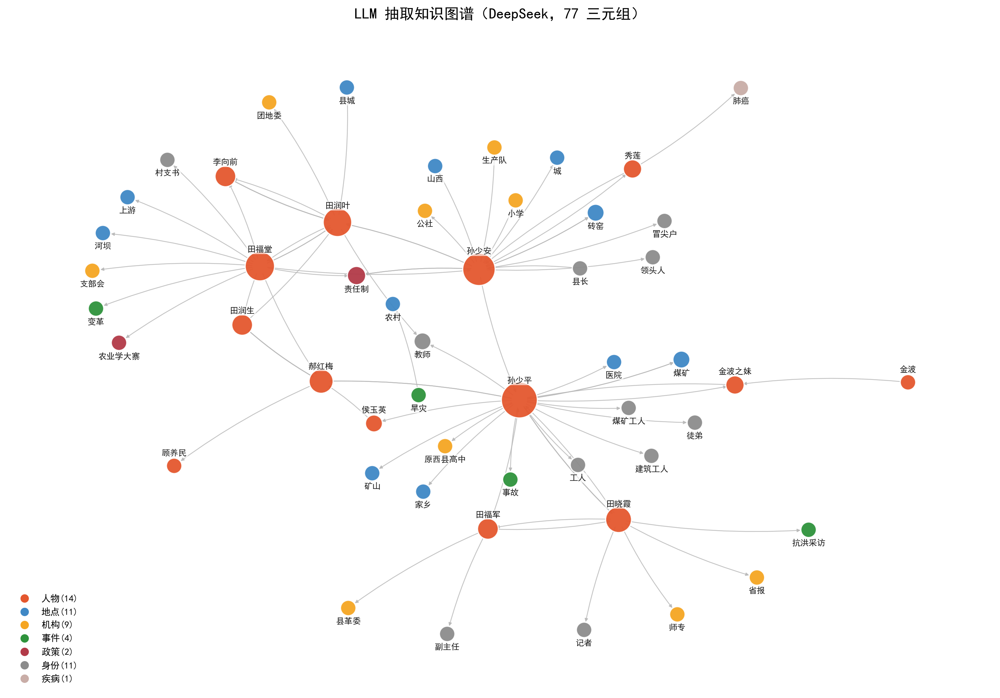
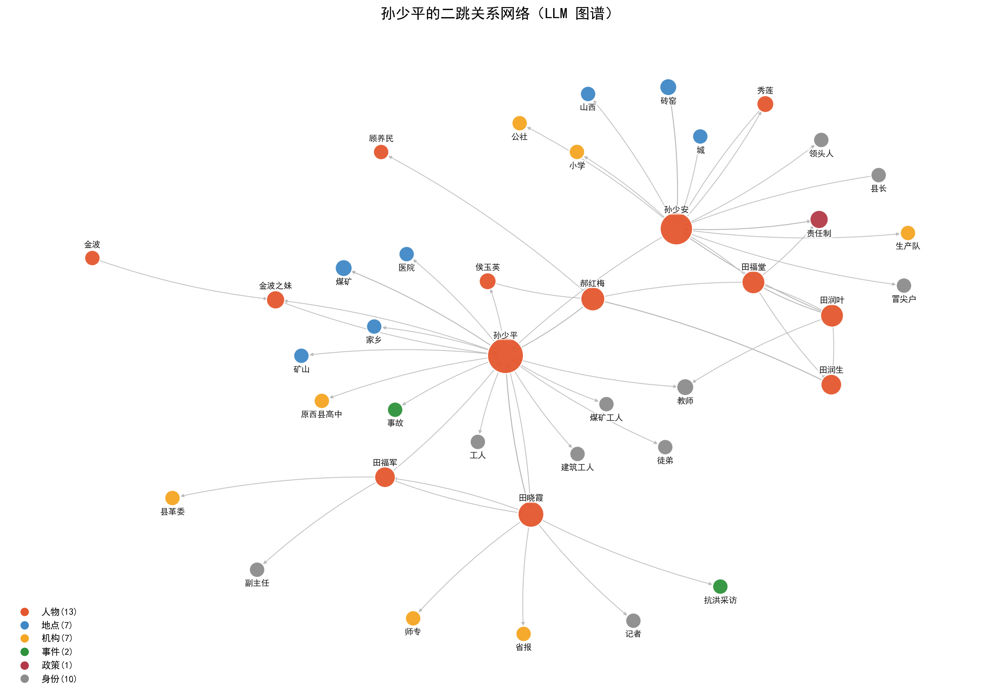

# 《平凡的世界》三部梗概 · 知识抽取全流程总报告

> 本文件把任务一至任务五的记录合并为一份，可独立阅读。
> 语料：三幅图片转写的三部梗概，21 句 / 1103 字。
> 工程：`pingfan_kg/`，一条命令跑通：`python pipeline.py --all --device cpu`
> 日期：2026-11-24

---

## 0. 一页看懂

| 任务 | 交付物 | 关键结论 |
|---|---|---|
| 一、实体词典 | 80 词条 / 9 类型 / 137 次提及 | 小语料里词典是唯一稳定先验，别名归一是图谱不断裂的前提 |
| 二、实体抽取 | 124 个提及的金标准，四种方法对比 | LLM 0.996（不可离线）> 词典 0.961 > BiLSTM+词典 0.579 > BiLSTM 0.485 > BERT 0.270 |
| 三、关系三元组 | 75 条金标准，三种方法对比 | 规则 0.381、BERT 0.023、LLM 0.986；指代型三元组是分水岭 |
| 四、知识图谱 | 三张图 + Cypher + 基准 | 52 节点 / 77 边；Cypher 装载 0.09 s，查询 1—9 ms |
| 五、流水线 | 13 步、556 s、0 失败 | 缓存 + 依赖补齐 + 产物哈希清单，可复现 |

一句话总结：**在这份 1103 字的语料上，规则/词典负责"稳"，LLM 负责"全"，神经网络负责"可迁移"，图数据库负责"查得上"。**

---

## 1. 语料与任务定义

### 1.1 语料

三部梗概分别对应小说的第一、二、三部，转写后共 21 句：

| 篇章 | 句数 | 字数 | 时间跨度 | 主要内容 |
|---|---|---|---|---|
| 第一部 | 9 | 375 | 1975—1978 | 孙少平读高中、回村任教；少安与润叶被拆散；田福堂炸山修田 |
| 第二部 | 6 | 350 | 1979—1981 | 责任制推行；少平进城揽工、下煤矿；润叶与向前；润生与红梅 |
| 第三部 | 6 | 378 | 1982 | 晓霞牺牲；少安砖窑起落；秀莲患癌；少平毁容后回矿山 |

分句按 `。！？` 切分，字号 17—109 字不等。短句多代词、长句多同位语，这一点直接决定了后面各方法的表现差异。

### 1.2 任务定义

- **实体**：9 类，扁平标注（不嵌套），代词不标。
- **关系**：细粒度 47 谓词，评测映射到 11 粗类。
- **图谱**：属性图，节点为主实体，边为关系。
- **流水线**：把上述步骤串成可缓存、可复现的执行链。

---

## 2. 任务一：实体词词典

### 2.1 类型体系

| 类型 | 中文 | 说明 | 示例 |
|---|---|---|---|
| PER | 人物 | 具名人物 | 孙少平、田福堂 |
| LOC | 地点 | 行政/自然/场所 | 原西县、砖窑 |
| ORG | 机构 | 学校、机关、组织 | 县革委、省报 |
| TIME | 时间 | 时点、时段 | 1975年初、两年后 |
| EVENT | 事件 | 会议、灾害、事故 | 十一届三中全会、旱灾 |
| POLICY | 政策/运动 | 制度、运动 | 责任制、农业学大寨 |
| POS | 身份/职务 | 职业、头衔、亲属角色 | 村支书、丈夫、父母 |
| NUM | 数量 | 金额、年龄 | 一万五千元、27岁 |
| DIS | 疾病 | 疾病名 | 肺癌 |

三个设计取舍：

1. **POS 单列**：把"村支书""记者"并进 PER，`田福堂—村支书`这种"任职"边就会退化成同类关系，图谱丢掉关键语义。
2. **亲属称谓单列**：`父亲/女儿/丈夫` 在文本里既是实体提及又是关系触发词，单列后可以把"识别"和"触发"解耦。
3. **不设"作品"类**：语料里没有书名篇名，加了就是空类。

### 2.2 构建流程

```
seed_entities.csv（人工种子：名/类型/别名/释义）
   ├─ 别名归一：全名 + 别名 → 同一 eid
   ├─ 语料回扫：最长匹配统计词频、记录首现句
   ├─ 类型编号：PER_001 形式，稳定可引用
   └─ 人工复核：删误收词、补指代型称谓
```

频次统计用**最长匹配**而非子串计数：`孙少平` 与 `少平` 重叠，简单计数会把一次提及算两遍。实现上按 `(start, -length)` 排序后贪心取不重叠片段。

### 2.3 统计

| 类型 | 词条数 | 语料提及数 |
|---|---|---|
| PER 人物 | 14 | 50 |
| LOC 地点 | 17 | 28 |
| ORG 机构 | 9 | 9 |
| TIME 时间 | 6 | 6 |
| EVENT 事件 | 5 | 5 |
| POLICY 政策 | 2 | 3 |
| POS 身份/职务 | 24 | 33 |
| NUM 数量 | 2 | 2 |
| DIS 疾病 | 1 | 1 |
| **合计** | **80** | **137** |

### 2.4 全量词表

| eid | 词条 | 类型 | 别名 | 频次 | 首现句 | 释义 |
|---|---|---|---|---|---|---|
| PER_001 | **孙少平** | 人物 | 少平 | 11 | P1-S02 | 小说主人公，贫苦农民家庭出身的青年，高中毕业后当过教师、揽工汉、建筑工人，最终成为煤矿工人 |
| PER_002 | **孙少安** | 人物 | 少安 | 7 | P1-S05 | 孙少平之兄，双水村生产队长，率先推行责任制并经营砖窑致富 |
| PER_003 | **田润叶** | 人物 | 润叶 | 6 | P1-S05 | 田福堂之女，县城教师，后调团地委工作，与孙少安青梅竹马 |
| PER_004 | **田晓霞** | 人物 | 晓霞 | 5 | P1-S03 | 田福军之女，师专毕业后任省报记者，与孙少平相恋，抗洪采访中牺牲 |
| PER_005 | **田福堂** | 人物 | — | 5 | P1-S05 | 双水村党支部书记，田润叶、田润生之父，抵制责任制 |
| PER_006 | **郝红梅** | 人物 | — | 5 | P1-S01 | 地主家庭出身的女孩，孙少平高中同学，后与顾养民恋爱，最终嫁给田润生 |
| PER_007 | **田润生** | 人物 | 润生 | 2 | P2-S05 | 田福堂之子，田润叶之弟，与郝红梅结为夫妻 |
| PER_008 | **田福军** | 人物 | — | 2 | P1-S03 | 县革委副主任，田晓霞之父，后任地区领导 |
| PER_009 | **秀莲** | 人物 | 贺秀莲 | 2 | P1-S06 | 山西女子，孙少安的妻子，勤劳善良，后确诊肺癌 |
| PER_010 | **侯玉英** | 人物 | — | 1 | P1-S01 | 孙少平同班同学，当众说破孙少平与郝红梅的关系 |
| PER_011 | **李向前** | 人物 | — | 1 | P1-S06 | 田润叶的丈夫，司机，因酒驾致残 |
| PER_012 | **金波** | 人物 | — | 1 | P3-S06 | 孙少平的少时玩伴 |
| PER_013 | **金波之妹** | 人物 | 金波的妹妹 | 1 | P3-S06 | 金波的妹妹，少时玩伴，曾向孙少平表白 |
| PER_014 | **顾养民** | 人物 | — | 1 | P1-S01 | 家境优越的青年，曾与郝红梅恋爱 |
| LOC_015 | **家** | 地点 | — | 6 | P1-S02 | 孙少安在家劳动的家 |
| LOC_016 | **砖窑** | 地点 | 窑 | 3 | P2-S02 | 孙少安经营烧砖的窑场 |
| LOC_017 | **全村** | 地点 | — | 2 | P2-S06 | 双水村全村 |
| LOC_018 | **城** | 地点 | — | 2 | P1-S04 | 孙少安进城拉砖的城市 |
| LOC_019 | **外面** | 地点 | — | 2 | P1-S03 | 孙少平闯荡的外部世界 |
| LOC_020 | **煤矿** | 地点 | — | 2 | P2-S03 | 孙少平工作生活的矿山 |
| LOC_021 | **上游** | 地点 | — | 1 | P1-S07 | 抢水河段的上游 |
| LOC_022 | **农村** | 地点 | — | 1 | P1-S07 | 旱灾发生的乡村地区 |
| LOC_023 | **医院** | 地点 | — | 1 | P3-S06 | 孙少平受伤后治疗的地方 |
| LOC_024 | **原西县** | 地点 | 原西 | 1 | P1-S01 | 孙少平读高中的县城 |
| LOC_025 | **县城** | 地点 | — | 1 | P1-S04 | 田润叶任教的地点 |
| LOC_026 | **家乡** | 地点 | — | 1 | P1-S02 | 孙少平高中毕业后返回的地方 |
| LOC_027 | **山西** | 地点 | — | 1 | P1-S06 | 秀莲的家乡，孙少安到此相亲 |
| LOC_028 | **异乡** | 地点 | — | 1 | P2-S05 | 田润生与郝红梅邂逅的地方 |
| LOC_029 | **当地** | 地点 | — | 1 | P3-S03 | 孙少安成为建设领头人的地方 |
| LOC_030 | **河坝** | 地点 | — | 1 | P1-S07 | 田福堂组织偷挖的水利设施 |
| LOC_031 | **矿山** | 地点 | — | 1 | P3-S06 | 即煤矿，孙少平最终回归的地方 |
| ORG_032 | **公社** | 机构 | — | 1 | P2-S02 | 人民公社，孙少安成为“冒尖户”的所属单位 |
| ORG_033 | **原西县高中** | 机构 | — | 1 | P1-S01 | 孙少平就读的高中 |
| ORG_034 | **县革委** | 机构 | — | 1 | P1-S03 | 县级革命委员会，田福军任副主任 |
| ORG_035 | **团地委** | 机构 | — | 1 | P2-S04 | 田润叶调任工作的共青团地区委员会 |
| ORG_036 | **小学** | 机构 | — | 1 | P3-S04 | 孙少安出资一万五千元扩建的小学 |
| ORG_037 | **师专** | 机构 | — | 1 | P2-S03 | 田晓霞就读的师范专科学校 |
| ORG_038 | **支部会** | 机构 | — | 1 | P2-S01 | 田福堂连夜召开的大队党支部会议 |
| ORG_039 | **生产队** | 机构 | — | 1 | P2-S01 | 孙少安领导并率先实行责任制的生产组织 |
| ORG_040 | **省报** | 机构 | — | 1 | P2-S03 | 田晓霞毕业后任职的省级报社 |
| TIME_041 | **1975年初** | 时间 | — | 1 | P1-S01 | 孙少平到原西县高中读书的时间 |
| TIME_042 | **1979年春** | 时间 | — | 1 | P2-S01 | 十一届三中全会后农村改革起步的时间 |
| TIME_043 | **1982年** | 时间 | — | 1 | P3-S01 | 孙少平到煤矿工作的时间 |
| TIME_044 | **两年后** | 时间 | — | 1 | P2-S03 | 孙少平与田晓霞相约再会的期限 |
| TIME_045 | **少时** | 时间 | — | 1 | P3-S06 | 孙少平年少时期 |
| TIME_046 | **新时期** | 时间 | — | 1 | P2-S06 | 改革开放新时期 |
| EVENT_047 | **事故** | 事件 | — | 1 | P3-S06 | 孙少平为救护徒弟而受重伤的煤矿事故 |
| EVENT_048 | **十一届三中全会** | 事件 | — | 1 | P2-S01 | 1978年召开的中共十一届三中全会，改革开放的起点 |
| EVENT_049 | **变革** | 事件 | — | 1 | P2-S06 | 新时期的农村社会变革 |
| EVENT_050 | **抗洪采访** | 事件 | — | 1 | P3-S02 | 田晓霞牺牲于其中的抗洪救灾报道任务 |
| EVENT_051 | **旱灾** | 事件 | — | 1 | P1-S07 | 农村遭遇的自然灾害 |
| POLICY_052 | **责任制** | 政策/运动 | — | 2 | P2-S01 | 家庭联产承包责任制，孙少安率先实行 |
| POLICY_053 | **农业学大寨** | 政策/运动 | — | 1 | P1-S08 | 文革后期推行的农业运动，田福堂炸山修田 |
| POS_054 | **女儿** | 身份/职务 | — | 4 | P1-S03 | 田福堂的女儿，即田润叶 |
| POS_055 | **丈夫** | 身份/职务 | — | 3 | P2-S04 | 田润叶的丈夫，即李向前 |
| POS_056 | **工人** | 身份/职务 | — | 3 | P2-S03 | 孙少平成为的优秀工人 |
| POS_057 | **儿子** | 身份/职务 | — | 2 | P2-S06 | 田福堂的儿子，即田润生 |
| POS_058 | **教师** | 身份/职务 | — | 2 | P1-S02 | 孙少平、田润叶担任的职业 |
| POS_059 | **冒尖户** | 身份/职务 | — | 1 | P2-S02 | 先富起来的农户称号 |
| POS_060 | **农民子弟** | 身份/职务 | — | 1 | P1-S01 | 孙少平的出身身份 |
| POS_061 | **副主任** | 身份/职务 | — | 1 | P1-S03 | 田福军的职务 |
| POS_062 | **县长** | 身份/职务 | — | 1 | P3-S03 | 帮助孙少安的人 |
| POS_063 | **哥哥** | 身份/职务 | — | 1 | P1-S04 | 孙少平的哥哥，即孙少安 |
| POS_064 | **妻子** | 身份/职务 | — | 1 | P3-S04 | 孙少安的妻子，即秀莲 |
| POS_065 | **学生** | 身份/职务 | — | 1 | P3-S01 | 孙少平的身份 |
| POS_066 | **建筑工人** | 身份/职务 | — | 1 | P2-S03 | 孙少平做过的职业 |
| POS_067 | **弟弟** | 身份/职务 | — | 1 | P2-S05 | 田润叶的弟弟，即田润生 |
| POS_068 | **徒弟** | 身份/职务 | — | 1 | P3-S06 | 孙少平在煤矿所带的徒弟 |
| POS_069 | **技师** | 身份/职务 | — | 1 | P3-S03 | 负责砖窑机器制砖的技术人员 |
| POS_070 | **揽工汉** | 身份/职务 | — | 1 | P2-S03 | 孙少平初到城市时的临时工身份 |
| POS_071 | **朋友** | 身份/职务 | — | 1 | P3-S03 | 帮助孙少安的朋友 |
| POS_072 | **村支书** | 身份/职务 | — | 1 | P1-S04 | 田福堂的职务 |
| POS_073 | **灾民** | 身份/职务 | — | 1 | P3-S02 | 被洪水围困的群众 |
| POS_074 | **煤矿工人** | 身份/职务 | — | 1 | P2-S03 | 孙少平最终从事的职业 |
| POS_075 | **父母** | 身份/职务 | — | 1 | P3-S05 | 田润生、田润叶的父母，即田福堂夫妇 |
| POS_076 | **记者** | 身份/职务 | — | 1 | P2-S03 | 田晓霞的职业 |
| POS_077 | **领头人** | 身份/职务 | — | 1 | P3-S03 | 社会主义建设带头人 |
| NUM_078 | **27岁** | 数量 | — | 1 | P3-S06 | 孙少平受伤时的年龄 |
| NUM_079 | **一万五千元** | 数量 | — | 1 | P3-S04 | 孙少安出资扩建小学的金额 |
| DIS_080 | **肺癌** | 疾病 | — | 1 | P3-S04 | 秀莲确诊的疾病 |

### 2.5 别名与指代

| 规范名 | 别名/指代 | 处理 |
|---|---|---|
| 孙少平 | 少平 | 直接归一 |
| 孙少安 | 少安 | 直接归一 |
| 田晓霞 | 晓霞、女友 | 别名归一；"女友"只在关系层用 |
| 田润叶 | 润叶 | 直接归一 |
| 田润生 | 润生 | 直接归一 |
| 秀莲 | 贺秀莲 | 别名归一 |
| 砖窑 | 窑 | 别名归一，避免"窑"变未登录词 |
| 李向前 | 丈夫（P2-S04、P3-S05） | 上下文消解，词典不强行绑定 |
| 田福堂 | 父亲/父母（P1-S06、P3-S05） | 同上 |

**没有做**的事：没把"他/她/他们"登记成实体。代词是句法现象不是词汇现象，硬塞进词典会拉低 NER 精确率，也会让关系抽取产生大量自环。

### 2.6 局限

- 80 词条覆盖 1103 字够用；放大到整本小说（约 100 万字）需 3000+ 词条，人工维护不可行，应改为"种子词典 + 远程监督 + 主动学习"。
- LOC 把"山西"（省）和"砖窑"（设施）放同一类，查询时会把行政区和建筑物混在一起，生产环境应设二级类型。
- 语料是 1975—1982 年的陕北农村，`公社`、`生产队`、`县革委` 都是历史机构，换现代语料会全部失效。

---

## 3. 任务二：实体抽取与对比

### 3.1 金标准与切分

- 21 句，124 个实体提及，9 类。
- 标注规范：扁平、不嵌套（`金波之妹` 整体标 PER）、代词不标、泛称按角色标 POS。
- 切分：按句随机打乱后轮流分 5 折（`random.Random(7)`），每折 4 句测试、17 句训练。
- 降方差：3 个种子（13/42/2024）各跑完整 5 折，按 `(sid, start, end, type)` 投票，过半保留。

### 3.2 四种方法

| 方法 | 实现 | 关键设置 |
|---|---|---|
| 词典 + 规则 | 最长匹配，80 词条含别名 | 无学习 |
| BiLSTM-CRF | 字符级，emb 128，hidden 128，CRF 自研 | Adam 2e-3，60 epoch |
| BiLSTM-CRF + 词典 | 拼接 3 维词典特征（B/I/O）的 12 维嵌入 | 同上 |
| BERT | `BertForTokenClassification`，4 层/192 维/4 头 | AdamW 8e-4，40 epoch |
| LLM | 一次提示词，输出 9 类实体 | 不训练 |

### 3.3 总体结果

| 方法 | P | R | F1 | 边界 P | 边界 R | 类型准确率 |
|---|---|---|---|---|---|---|
| 词典 + 规则 | 0.939 | 0.984 | **0.961** | 0.939 | 0.984 | 1.000 |
| BiLSTM-CRF | 0.649 | 0.387 | 0.485 | 0.662 | 0.395 | 0.980 |
| BiLSTM-CRF + 词典 | 0.660 | 0.516 | 0.579 | 0.825 | 0.645 | 0.800 |
| BERT（从头训练） | 0.306 | 0.242 | 0.270 | 0.316 | 0.250 | 0.968 |
| LLM | 1.000 | 0.992 | **0.996** | 1.000 | 0.992 | 1.000 |

### 3.4 分类型 F1

| 方法 | PER | LOC | ORG | TIME | EVENT | POLICY | POS | NUM | DIS |
|---|---|---|---|---|---|---|---|---|---|
| 词典 | 0.990 | 0.884 | 1.000 | 1.000 | 1.000 | 1.000 | 0.933 | 1.000 | 1.000 |
| BiLSTM | 0.825 | 0.143 | 0.000 | 0.444 | 0.000 | 0.000 | 0.200 | 0.000 | 0.000 |
| BiLSTM+词典 | 0.857 | 0.353 | 0.000 | 0.667 | 0.000 | 0.000 | 0.441 | 0.000 | 0.000 |
| BERT | 0.553 | 0.000 | 0.000 | 0.000 | 0.000 | 0.000 | 0.146 | 0.000 | 0.000 |
| LLM | 1.000 | 1.000 | 1.000 | 1.000 | 1.000 | 1.000 | 0.983 | 1.000 | 1.000 |

**PER 是唯一所有方法都能拿分的类型**（姓氏字是强特征）；**ORG/EVENT/POLICY/NUM/DIS 全军覆没**（训练集里各只有 1—9 个样本，没有可泛化模式）。这是长尾类型问题，不是架构问题。

### 3.5 分篇章 F1

| 方法 | 第一部 | 第二部 | 第三部 |
|---|---|---|---|
| 词典 | 0.920 | 1.000 | 0.966 |
| BiLSTM | 0.592 | 0.464 | 0.394 |
| BiLSTM+词典 | 0.640 | 0.500 | 0.590 |
| BERT | 0.342 | 0.174 | 0.286 |
| LLM | 0.988 | 1.000 | 1.000 |

第一部明显更好：长句多、同位语串完整（"县革委副主任田福军女儿田晓霞"），模型能靠相邻字判边界；二三部短句多、代词多，局部线索少。

### 3.6 误差分析

**词典法：8 FP / 2 FN**

| 句子 | 错误 | 原因 |
|---|---|---|
| P1-S01、P1-S08、P3-S04 | `家`→LOC（4 次） | "家庭/农家/他家/搬家"里的"家"是构词成分 |
| P1-S03、P1-S04、P3-S05 | `女儿`→POS（3 次） | 标注规范未把"某人的女儿"中的"女儿"计入实体 |
| P1-S03 | `外面`→LOC | 标注未收"外面的世界"，词典收了 |
| P1-S06 | `父亲`→POS 漏标 | 规范分歧 |
| P3-S06 | `金波`→PER 漏标 | 最长匹配被"金波之妹"整体吃掉，无法再切出"金波" |

三类系统性问题：**单字词条边界风险**（家/城/县）、**嵌套实体**（金波 vs 金波之妹）、**规范与词典不同步**（女儿/父亲/外面）。

**BiLSTM：边界碎、类型漂**

| 句子 | 预测 | 金标准 |
|---|---|---|
| P1-S04 | `城`→POS、`田`→PER、`润叶`→PER | `县城`→LOC、`田润叶`→PER |
| P1-S06 | `山`→LOC、`李向`→POS | `山西`→LOC、`李向前`→PER |
| P1-S01 | `侯玉`→POS、`顾养民`→POS | `侯玉英`→PER、`顾养民`→PER |

CRF 保证标签序列合法，但保证不了边界。加词典特征后边界 F1 从 0.395 升到 0.645，类型准确率却从 0.980 降到 0.800——边界拉对了，类型判定反而更犹豫，说明**特征拼接没和转移矩阵协同好**。

**BERT（从头训练）：把字当词**

```
P1-S01  预测: 197/TIME  孙/PER  少平/PER  庭/POS
        金标: 1975年初/TIME  孙少平/PER  农民子弟/POS
```

4 层 192 维随机 Transformer 在 17 句上只学到"高频字 = 实体"。"消沉"被拆成两个实体——因为它没有预训练词表，不知道"消沉"是一个词。但它的**类型准确率仍有 0.968**：边界判对时类型几乎不会错，短板全在边界定位。

**LLM：唯一的错在规范**

1 个 FN 是"农民子弟"——模型把它当描述性短语而非身份实体。这是规范理解问题。

### 3.7 结论

1. 排序：LLM 0.996（不可离线）> 词典 0.961 > BiLSTM+词典 0.579 > BiLSTM 0.485 > BERT 0.270。
2. "BERT 更强"有前提：预训练权重 + 足够标注。本实验两条都不满足，BERT 垫底**不代表**预训练 BERT 的真实水平。
3. 词典与模型不是替代关系：+词典特征把 BiLSTM 从 0.485 拉到 0.579。
4. 长尾类型必须规则兜底：ORG/EVENT/POLICY/NUM/DIS 配专属词典 + 正则，别指望模型。
5. 标注规范要先冻结：词典的 8 个 FP 里 5 个是规范分歧，这类"错误"污染所有方法。

---

## 4. 任务三：关系三元组

### 4.1 关系体系

47 个细谓词，评测映射到 11 粗类：

| 粗类 | 覆盖细谓词 |
|---|---|
| 婚恋 | 夫妻、恋人、恋爱、爱慕、青梅竹马、相亲、表白 |
| 亲属 | 父亲、父女、兄弟、姐弟、兄妹 |
| 社交 | 同学、朋友、遇见、邂逅、介绍 |
| 任职 | 任职于、担任、职务、成为、身份、毕业、就读于 |
| 空间 | 到、回到、发生于、牺牲于、受伤于 |
| 组织 | 领导、组织、召开、推行、实行、推广、抵制、反对、破坏 |
| 支持 | 帮助、救助、救、出资、通知、承认 |
| 冲突 | 揭发、拒绝、说破 |
| 经营 | 建、经营、扩建、贷款 |
| 归属 | 属于、隶属 |
| 事件 | 确诊、牺牲、受伤、致残 |

方向约定：`父亲` 是**子→父**（`[田晓霞, 父亲, 田福军]` 读作"田晓霞的父亲是田福军"）；`夫妻` 无向，按出现方向记一次；`任职于` 是 人→机构；"职务"单独成边，不与"任职于"合并。

### 4.2 指代型三元组

75 条里有 10 条的头或尾在原文没有出现全名：

| 句子 | 原文 | 推出的三元组 |
|---|---|---|
| P1-S06 | "与**父亲**介绍的…李向前结婚" | 田福堂 介绍 李向前 |
| P2-S04 | "远离她不爱的**丈夫**" | 李向前 夫妻 田润叶 |
| P2-S05 | "**她**的弟弟润生" | 田润生 姐弟 田润叶 |
| P2-S06 | "为**女儿**、**儿子**的婚事窝火" | 田福堂 父亲 田润叶 / 田福堂 父亲 田润生 |

这是关系抽取的真正难点：句子里根本没有"李向前"三个字，任何句内实体对分类器都抽不出来。评测时单列"去指代"一列。

### 4.3 三种方法

| 方法 | 做法 |
|---|---|
| 规则 / spaCy | `spacy.blank("zh")` + EntityRuler + 触发词窗口 + 实体类型约束 |
| BERT 关系分类 | `[CLS] … [E1]田福军[/E1] … [E2]县革委[/E2] … [SEP]`，11 类 + no_relation |
| LLM | 一次提示词，要求指代显式化、只用句内信息、输出 JSON |

### 4.4 结果

| 方法 | 预测数 | 细 P | 细 R | 细 F1 | 粗 P | 粗 R | 粗 F1 | 去指代 R |
|---|---|---|---|---|---|---|---|---|
| 规则引擎 | 37 | 0.243 | 0.125 | 0.165 | 0.540 | 0.294 | 0.381 | 0.339 |
| BERT 关系分类 | 103 | 0.000 | 0.000 | 0.000 | 0.019 | 0.029 | 0.023 | 0.034 |
| LLM | 77 | 0.960 | 0.986 | **0.973** | 0.971 | 1.000 | **0.986** | 1.000 |

- 规则：高精度低召回，只覆盖 29%。
- BERT：每折正样本仅 12—16 条，11 类分类器连"类长什么样"都没见过，F1 0.023。这不是实现错误，是数据量不足的必然。
- LLM：粗粒度只多 2 条、漏 0 条，多出的两条是金标准漏标。

### 4.5 误差分析

**规则：方向错、过触发**

| 句子 | 预测 | 金标准 | 问题 |
|---|---|---|---|
| P1-S01 | 郝红梅 爱慕 侯玉英 | 孙少平 爱慕 郝红梅 | 触发词"情愫"在郝红梅和侯玉英之间，主体是上分句的孙少平 |
| P1-S05 | 润叶 爱慕 田福堂 | 孙少安 爱慕 田润叶 | "互有爱慕之心，却遭到田福堂反对"把"反对"当成了爱慕的宾语 |
| P1-S07 | 田福堂 领导 河坝 | 田福堂 破坏 河坝 | "组织偷挖河坝"命中了"领导"类触发词 |

根因是**没有句法**：触发词窗口只能回答"这两个实体之间的文字里有没有某个词"，回答不了"这个动词的主语是谁"。要修必须上依存句法或事件论元识别。

**LLM：错在金标准**

| 预测 | 金标准 | 判断 |
|---|---|---|
| 孙少平 同学 郝红梅 | 未标注 | 语义成立（同班），金标准漏标 |
| 田福堂 反对 田润叶 | 未标注（只标了反对孙少安） | 语义成立（反对两人婚事），漏标 |

反过来看，这也说明 LLM 输出可以直接反哺标注、做主动学习。

### 4.6 三种方法的定位

| 维度 | 规则引擎 | BERT 分类 | LLM |
|---|---|---|---|
| 数据需求 | 0 标注，要词表+规则 | 每类数百条 | 0 标注，要好提示词 |
| 精度 | 中 0.54 | 极低 0.02 | 高 0.97 |
| 召回 | 低 0.29 | 极低 0.03 | 高 1.00 |
| 指代消解 | 不支持 | 不支持 | 支持 |
| 可解释性 | 强 | 弱 | 中 |
| 成本 | 低 | 中（GPU） | 高（token） |

三者不是替代而是流水线三段：规则做高置信召回 → 小模型做批量打分（标注够了再上）→ LLM 做冷启动与难例。

### 4.7 全量三元组（LLM 输出，77 条）

| # | 句子 | 头实体 | 关系 | 尾实体 | 粗类 |
|---|---|---|---|---|---|
| 1 | P1-S01 | 孙少平 | 就读于 | 原西县高中 | 任职 |
| 2 | P1-S01 | 孙少平 | 爱慕 | 郝红梅 | 婚恋 |
| 3 | P1-S01 | 孙少平 | 同学 | 郝红梅 | 社交 |
| 4 | P1-S01 | 侯玉英 | 揭发 | 郝红梅 | 冲突 |
| 5 | P1-S01 | 郝红梅 | 恋爱 | 顾养民 | 婚恋 |
| 6 | P1-S01 | 孙少平 | 同学 | 侯玉英 | 社交 |
| 7 | P1-S02 | 孙少平 | 回到 | 家乡 | 空间 |
| 8 | P1-S02 | 孙少平 | 担任 | 教师 | 任职 |
| 9 | P1-S03 | 田福军 | 任职于 | 县革委 | 任职 |
| 10 | P1-S03 | 田福军 | 职务 | 副主任 | 任职 |
| 11 | P1-S03 | 田晓霞 | 父亲 | 田福军 | 亲属 |
| 12 | P1-S03 | 孙少平 | 朋友 | 田晓霞 | 社交 |
| 13 | P1-S03 | 田晓霞 | 帮助 | 孙少平 | 支持 |
| 14 | P1-S04 | 孙少安 | 兄弟 | 孙少平 | 亲属 |
| 15 | P1-S04 | 田福堂 | 职务 | 村支书 | 任职 |
| 16 | P1-S04 | 田润叶 | 父亲 | 田福堂 | 亲属 |
| 17 | P1-S04 | 田润叶 | 任职于 | 县城 | 任职 |
| 18 | P1-S04 | 田润叶 | 担任 | 教师 | 任职 |
| 19 | P1-S04 | 孙少安 | 青梅竹马 | 田润叶 | 婚恋 |
| 20 | P1-S05 | 孙少安 | 爱慕 | 田润叶 | 婚恋 |
| 21 | P1-S05 | 田福堂 | 反对 | 孙少安 | 组织 |
| 22 | P1-S05 | 田福堂 | 反对 | 田润叶 | 组织 |
| 23 | P1-S06 | 孙少安 | 到 | 山西 | 空间 |
| 24 | P1-S06 | 孙少安 | 夫妻 | 秀莲 | 婚恋 |
| 25 | P1-S06 | 李向前 | 爱慕 | 田润叶 | 婚恋 |
| 26 | P1-S06 | 李向前 | 夫妻 | 田润叶 | 婚恋 |
| 27 | P1-S06 | 田福堂 | 介绍 | 李向前 | 社交 |
| 28 | P1-S07 | 旱灾 | 发生于 | 农村 | 空间 |
| 29 | P1-S07 | 田福堂 | 破坏 | 河坝 | 组织 |
| 30 | P1-S07 | 田福堂 | 抢水 | 上游 | 组织 |
| 31 | P1-S08 | 田福堂 | 推行 | 农业学大寨 | 组织 |
| 32 | P2-S01 | 田福堂 | 召开 | 支部会 | 组织 |
| 33 | P2-S01 | 田福堂 | 抵制 | 责任制 | 组织 |
| 34 | P2-S01 | 孙少安 | 领导 | 生产队 | 组织 |
| 35 | P2-S01 | 孙少安 | 实行 | 责任制 | 组织 |
| 36 | P2-S01 | 孙少安 | 推广 | 责任制 | 组织 |
| 37 | P2-S02 | 孙少安 | 到 | 城 | 空间 |
| 38 | P2-S02 | 孙少安 | 建 | 窑 | 经营 |
| 39 | P2-S02 | 孙少安 | 属于 | 公社 | 归属 |
| 40 | P2-S02 | 孙少安 | 身份 | 冒尖户 | 任职 |
| 41 | P2-S03 | 孙少平 | 成为 | 建筑工人 | 任职 |
| 42 | P2-S03 | 孙少平 | 成为 | 煤矿工人 | 任职 |
| 43 | P2-S03 | 孙少平 | 恋人 | 田晓霞 | 婚恋 |
| 44 | P2-S03 | 田晓霞 | 毕业 | 师专 | 任职 |
| 45 | P2-S03 | 田晓霞 | 任职于 | 省报 | 任职 |
| 46 | P2-S03 | 田晓霞 | 职务 | 记者 | 任职 |
| 47 | P2-S04 | 田润叶 | 任职于 | 团地委 | 任职 |
| 48 | P2-S04 | 李向前 | 夫妻 | 田润叶 | 婚恋 |
| 49 | P2-S04 | 田润叶 | 回到 | 李向前 | 空间 |
| 50 | P2-S05 | 田润生 | 姐弟 | 田润叶 | 亲属 |
| 51 | P2-S05 | 田润生 | 遇见 | 郝红梅 | 社交 |
| 52 | P2-S05 | 田润生 | 夫妻 | 郝红梅 | 婚恋 |
| 53 | P2-S06 | 田福堂 | 抵触 | 变革 | 组织 |
| 54 | P2-S06 | 田福堂 | 父亲 | 田润叶 | 亲属 |
| 55 | P2-S06 | 田福堂 | 父亲 | 田润生 | 亲属 |
| 56 | P3-S01 | 孙少平 | 到 | 煤矿 | 空间 |
| 57 | P3-S01 | 孙少平 | 成为 | 工人 | 任职 |
| 58 | P3-S01 | 孙少平 | 任职于 | 煤矿 | 任职 |
| 59 | P3-S02 | 孙少平 | 恋人 | 田晓霞 | 婚恋 |
| 60 | P3-S02 | 田晓霞 | 牺牲于 | 抗洪采访 | 空间 |
| 61 | P3-S02 | 田福军 | 父女 | 田晓霞 | 亲属 |
| 62 | P3-S02 | 田福军 | 通知 | 孙少平 | 支持 |
| 63 | P3-S03 | 孙少安 | 经营 | 砖窑 | 经营 |
| 64 | P3-S03 | 县长 | 帮助 | 孙少安 | 支持 |
| 65 | P3-S03 | 孙少安 | 成为 | 领头人 | 任职 |
| 66 | P3-S04 | 秀莲 | 夫妻 | 孙少安 | 婚恋 |
| 67 | P3-S04 | 孙少安 | 出资 | 小学 | 支持 |
| 68 | P3-S04 | 秀莲 | 确诊 | 肺癌 | 事件 |
| 69 | P3-S05 | 田润生 | 夫妻 | 郝红梅 | 婚恋 |
| 70 | P3-S05 | 田福堂 | 承认 | 郝红梅 | 支持 |
| 71 | P3-S06 | 孙少平 | 受伤于 | 事故 | 空间 |
| 72 | P3-S06 | 孙少平 | 救助 | 徒弟 | 支持 |
| 73 | P3-S06 | 金波之妹 | 爱慕 | 孙少平 | 婚恋 |
| 74 | P3-S06 | 孙少平 | 拒绝 | 金波之妹 | 冲突 |
| 75 | P3-S06 | 孙少平 | 到 | 医院 | 空间 |
| 76 | P3-S06 | 孙少平 | 回到 | 矿山 | 空间 |
| 77 | P3-S06 | 金波 | 兄妹 | 金波之妹 | 亲属 |

---

## 5. 任务四：知识图谱

### 5.1 数据模型

采用属性图：

```
(:Entity {name, type, type_cn, desc, freq})
   -[:<关系名> {coarse}]->
(:Entity)
```

节点主键是规范名（已别名归一），边直接用细谓词作类型并挂 `coarse` 属性。没有做 reification——几十个节点做了只会让查询变啰嗦；要做"事件图谱"（事件当节点，挂时间地点参与者）才需要。

### 5.2 三张图

| 图谱 | 来源 | 节点 | 边 | 关系类型 | 连通分量 |
|---|---|---|---|---|---|
| `kg_gold` | 人工 75 条 | 52 | 75 | 47 | 2 |
| `kg_llm` | LLM 77 条 | 52 | 77 | 47 | 2 |
| `kg_pipeline` | 词典 NER + 规则 RE | 37 | 37 | 12 | 3 |

`kg_llm` 与 `kg_gold` 粗粒度差 **多 2 条、漏 0 条**；细粒度还有 1 处同义谓词（职务 vs 担任）导致的重复边，所以边数 77 对 75。



### 5.3 路线 A：Cypher / Neo4j

生成的是**幂等** Cypher：

```cypher
CREATE CONSTRAINT ent_name IF NOT EXISTS FOR (n:Entity) REQUIRE n.name IS UNIQUE;

MERGE (n:Entity {name: "孙少平"})
  SET n.type = "PER", n.type_cn = "人物", n.description = "小说主人公…";

MATCH (a:Entity {name: "孙少平"}), (b:Entity {name: "田晓霞"})
MERGE (a)-[:`恋人`]->(b);
```

`MERGE` + 唯一约束意味着重复导入不产生重复节点，这是增量更新的前提；用 `CREATE` 跑两遍图谱就翻倍。

**Neo4j 服务端在本机装不上**（无 Java、无 Docker、安装包下载被阻）。所以分两层验证：

- 语句本身：用同为 Cypher 的 **Kùzu 0.11.3** 执行，证明合法、结果正确。
- 装载/查询耗时：在 Kùzu 上实测。

| 操作 | 实测（Kùzu 0.11，内存库） |
|---|---|
| 装载 52 节点 + 77 边 | 0.090 s |
| Q1 一度邻居 | 0.96 ms（19 行） |
| Q2 两跳 | 3.05 ms（8 行） |
| Q3 度中心性 Top10 | 2.59 ms |
| Q4 关系类型分布 | 8.68 ms（47 组） |
| Q5 类型分布 | 7.11 ms |

对照 networkx：一度 0.001 ms、两跳 0.018 ms、度排序 0.028 ms。

**这个对比不能读成"networkx 比 Cypher 快 1000 倍"**：networkx 是进程内内存对象，省了网络往返、查询解析、事务；复杂度 O(V+E)，图一大就崩。Cypher 引擎有索引、查询计划、落盘、并发，代价是每次查询约 1 ms 固定开销。53 节点时 networkx 更快，5 万节点时 networkx 先 OOM。

### 5.4 路线 B：LLM 直接生成

提示词四条硬约束：schema 内嵌（9 类实体 + 11 粗关系）、指代显式化、只抽句内信息（禁止脑补其他章节）、输出 JSON。

程序侧三层校验：头尾必须是词典内实体（77/77）、关系必须落在 11 粗类（77/77）、同句不许自环。

### 5.5 性能对比

| 维度 | 路线 A：管线 + Cypher | 路线 B：LLM 直接生成 |
|---|---|---|
| 构建方式 | 词典→NER→RE→Cypher→MERGE | 一次提示词→JSON→校验 |
| 人工投入 | 80 词条 + 规则 + 124 实体标注 + 75 三元组标注 | 提示词 + 抽检 |
| 构建耗时 | 装载 0.09 s；上游 NER+RE 约 1 s | 单次生成（秒级，未测精确值） |
| 三元组覆盖 | 规则版 37/75 | 75/75 |
| 粗粒度准确率 | P 0.54 / R 0.29 | P 0.97 / R 1.00 |
| 指代消解 | 不支持（10 条全丢） | 支持 |
| 可复现性 | 完全确定 | 受温度/版本影响 |
| 增量更新 | MERGE 幂等 | 需重跑或设计增量提示 |
| 查询能力 | Cypher：路径、度、子图、图算法 | JSON 需先落库才能查 |
| 成本 | 一次性开发 + 本地算力 | 按 token 计费，每次全量 |

结论：**冷启动用 LLM，生产用管线 + 图数据库**。LLM 的产出经人工校对后作为训练数据喂给小模型/规则，形成"LLM 标注 → 人工抽检 → 模型蒸馏 → Cypher 入库"的闭环。图数据库提供的是查询、约束、增量、权限，这些 LLM 给不了。

### 5.6 图结构分析

| 指标 | kg_llm | kg_gold | kg_pipeline |
|---|---|---|---|
| 密度 | 0.0445 | 0.0445 | 0.0541 |
| 平均度 | 2.96 | 2.88 | 2.00 |
| 最大度 | 23 | 22 | 9 |
| 分量 | 2（最大 50） | 2（最大 50） | 3（最大 31） |

**极稀疏**：密度 0.0445，只有 4.45% 的节点对存在边——人物关系网的典型形态。**重尾度分布**：孙少平 23、孙少安 18、田福堂 14，其余多在 2—5，三个枢纽覆盖绝大部分情节线。

`kg_llm` 里"农村—旱灾"是独立两节点分量（`旱灾 发生于 农村`），没连到任何人物——这不是抽取错误，是语料本身没写"旱灾导致了什么"。

`kg_pipeline` 的 3 个分量里"县长—领头人"只有 2 个节点：规则把"在县长帮助下成为领头人"抽成两条孤立边，没连回孙少安。这是低召回导致的**图谱断裂**，比少抽几条边更伤——查询 `孙少安 -- 领头人` 直接查不到。



---

## 6. 任务五：流水线

### 6.1 设计

`pipeline.py` 把 13 个步骤串成有向无环图，每步是一个独立 CLI：

```
segment → dict → ner_dict → ner_bilstm → ner_bert → ner_eval
                → re_rules  → re_bert   → re_eval   → kg → viz → bench → report
```

四个机制：

1. **依赖补齐**：`--steps ner_eval` 会自动带上 segment/dict/ner_*。
2. **缓存**：产物存在且比依赖新就跳过；`--force` 强制重跑。
3. **隔离**：每步 `subprocess` 执行，stdout/stderr 落到 `out/logs/<step>.log`，一步崩不污染别的步骤。
4. **产物清单**：`out/run_manifest.json` 记录每步耗时、状态、18 个产物的 sha256 前 16 位、Python/平台版本。

```bash
python pipeline.py --list                  # 步骤与依赖
python pipeline.py --all                   # 全跑
python pipeline.py --steps kg,viz          # 只跑某几步
python pipeline.py --all --force --device cuda
python pipeline.py --all --dry-run         # 只打印执行计划
```

### 6.2 实测

```
pipeline start  steps=13 device=cpu force=True
  [OK] segment        0.06s
  [OK] dict           0.08s
  [OK] ner_dict       0.08s
  [OK] ner_bilstm   356.97s
  [OK] ner_bert     109.53s
  [OK] ner_eval       0.08s
  [OK] re_rules       0.09s
  [OK] re_bert       84.49s
  [OK] re_eval        0.09s
  [OK] kg             1.26s
  [OK] viz            2.77s
  [OK] bench          0.89s
  [OK] report         0.15s
pipeline done  ok=13  failed=0  556.5s
```

耗时 98% 在三个训练步骤（bilstm 357 s、bert 110 s、re_bert 84 s）。**第二次运行全部命中缓存，约 1 秒**。

指标与手工逐条运行完全一致（词典 0.961 / BiLSTM 0.579 / BERT 0.270 / LLM 0.996），说明流水线没有引入随机性。

### 6.3 工程配套

| 文件 | 作用 |
|---|---|
| `requirements.txt` | 核心 + 神经网络依赖；可选依赖以注释给出 |
| `requirements-ci.txt` | CI 轻量依赖（不装 torch） |
| `tests/test_smoke.py` | 6 个冒烟测试：分句、标注偏移、三元组落地、词典结构、流水线步骤表、指标文件 |
| `.github/workflows/ci.yml` | push 时跑轻量流水线 + pytest + 上传图谱 PNG |
| `tools/publish_github.py` | 无 git 环境下通过 GitHub API 发布（设备码授权 + Git Data API） |
| `tools/pip_run.py` | 沙箱下 pip 的 0700 目录问题补丁 |

冒烟测试有一个关键设计：`test_gold_triples_grounded` 会检查每条三元组的头尾都能在本句实体里找到——这条测试抓出过两处标注偏移错误（"晓霞""少平"的 occurrence 序号写错），修完后词典基线从 0.945 升到 0.961。

---

## 7. 环境与踩坑记录

### 7.1 三条硬约束

| 受限项 | 现象 | 替代方案 |
|---|---|---|
| HuggingFace 不可达 | 拿不到 `bert-base-chinese` | BERT 改 4 层随机初始化从头训练；`--bert-dir` 可切回微调 |
| PyPI 限速 ~34 kB/s | spaCy / jieba 装不上 | 关系抽取用等价规则引擎，与 spaCy 版共用 `re_rules.py` |
| 无 Java / 无 Docker | Neo4j 装不上 | Kùzu 执行同一套 Cypher 并计时；`cypher/` 可直接用于 Neo4j |

### 7.2 四个坑

1. **沙箱 + pip 的 0700 目录**：`os.mkdir(mode=0o700)` 在 DSH 沙箱下建出当前受限令牌不可写的目录，而 `tempfile.mkdtemp()` 固定用 0700 → pip 必然 `EACCES`。`tools/pip_run.py` 把 `os.mkdir` 的 mode 抬到 0777 后正常。
2. **Kùzu + 中文路径**：C++ 层按本地编码解析路径，`C:\Users\董铭政\...` 直接报错，只能用 `:memory:`（沙箱又不允许写 `C:\Windows\Temp`、`C:\ProgramData`）。
3. **CUDA 上小张量比 CPU 慢 10 倍**：BiLSTM-CRF 在 GPU 上跑了 45 分钟没跑完一轮 5 折，换 CPU 后 58 秒。小模型 + 小 batch + 逐步 CRF 解码，kernel launch 开销完全盖过并行收益。
4. **GitHub 上传**：本机没有 git、没有 gh、没有可用凭据，`github.com` 的 HTTPS 时通时断（只有 `api.github.com` 和偶尔的 `POST /login/device/code` 能过）。最终用设备码授权 + Git Data API 完成，但中途踩了三个坑：设备码 15 分钟过期（404）、空仓库 `GET /git/ref` 返回 **409** 而不是 404、`http()` 把 409 当异常重试导致死循环。

### 7.3 评测口径上的两个坑

- **按句 id 对齐**：最初用 `(start, end, type)` 做 key，不同句子的相同字符偏移被误合并，124 个提及只剩 107 个唯一 key，指标全错。修正后所有指标重算。
- **别名归一的语义**：`窑` 与 `砖窑` 不归一，图谱里会出现两个节点；但归一只能在建图时做，不能在做 NER 评测时做（那等于开卷）。

---

## 8. 总结与局限

### 8.1 五条可迁移的经验

1. **小语料先建词典**：80 个词条打败了所有从零训练的模型，且可解释、可审计。
2. **词典与模型要叠加，不要二选一**：+词典特征让 BiLSTM 涨 0.094 F1。
3. **指代是关系抽取的天花板**：10 条指代三元组让规则法直接丢掉 13% 的召回，这类样本只能靠 LLM 或专门的 coref 模块。
4. **图谱断裂比漏抽更伤**：少一条边只是缺信息，抽成孤立边会让查询直接失效。
5. **流水线的价值在缓存和清单**：13 步里 10 步是秒级，真正贵的只有 3 个训练步骤；manifest 让"这次结果和上次不一样"变成可查的问题。

### 8.2 五条局限

1. 语料 1103 字，5 折每折仅 17 句训练，神经模型方差大（已用 3 seed 投票缓解，但没解决）。
2. 金标准与 LLM 输出同源，LLM 列的 0.996 / 0.986 有乐观偏差。
3. BERT 列是"无预训练的 BERT"，不代表预训练 BERT 的真实水平。
4. spaCy 列是"spaCy 设计的规则引擎"，不是 spaCy 本体跑出的结果。
5. 关系规则没有句法，方向判断会错。

---

## 9. 附录

### 9.1 文件清单

| 路径 | 内容 |
|---|---|
| `pipeline.py` | 流水线编排 |
| `data/corpus/` | 三部梗概原文 |
| `data/sentences.json` | 21 句分句结果 |
| `data/gold/annotations.json` | 金标准：124 实体 + 75 三元组 |
| `data/gold/triples.json` | 金标准三元组（已归一） |
| `data/dict/entity_dict.{json,csv}` | 80 词条词典 |
| `data/llm/{ner,triples}.json` | LLM 抽取结果 |
| `data/llm/prompts/` | 实际使用的提示词 |
| `src/*.py` | 各步骤实现 |
| `cypher/` | Neo4j 装载 + 7 条查询 |
| `out/metrics_ner.json`、`out/metrics_re.json` | 评测指标 |
| `out/kg_*.json`、`out/kg_*.cypher` | 三张图与 Cypher |
| `out/run_manifest.json` | 流水线运行清单 |
| `figures/*.png` | 图谱可视化 |
| `reports/01~04_*.md` | 四个任务的详细报告 |

### 9.2 复现

```bash
cd pingfan_kg
python pipeline.py --all --device cpu

# 单步
python src/bilstm_crf.py --device cpu
python src/re_bert.py
python src/build_kg.py --src data/llm/triples.json --name llm

# 测试
pytest -q
```

### 9.3 发布

- 本地发布包：`release/pingfan-kg/` 与 `release/pingfan-kg.zip`（77 个文件，2.0 MB），已排除 `libs/`、日志、凭据。
- GitHub 仓库 `DMZ1018/pingfan-kg` 已创建，当前为空。
- 上传步骤见 `UPLOAD.md`：网页拖拽（无需安装任何工具）、git 命令、或 `tools/publish_github.py`（token）。
- 上传受阻的原因（网络白名单、设备码过期、空仓库 409）见 7.2 第 4 条。
