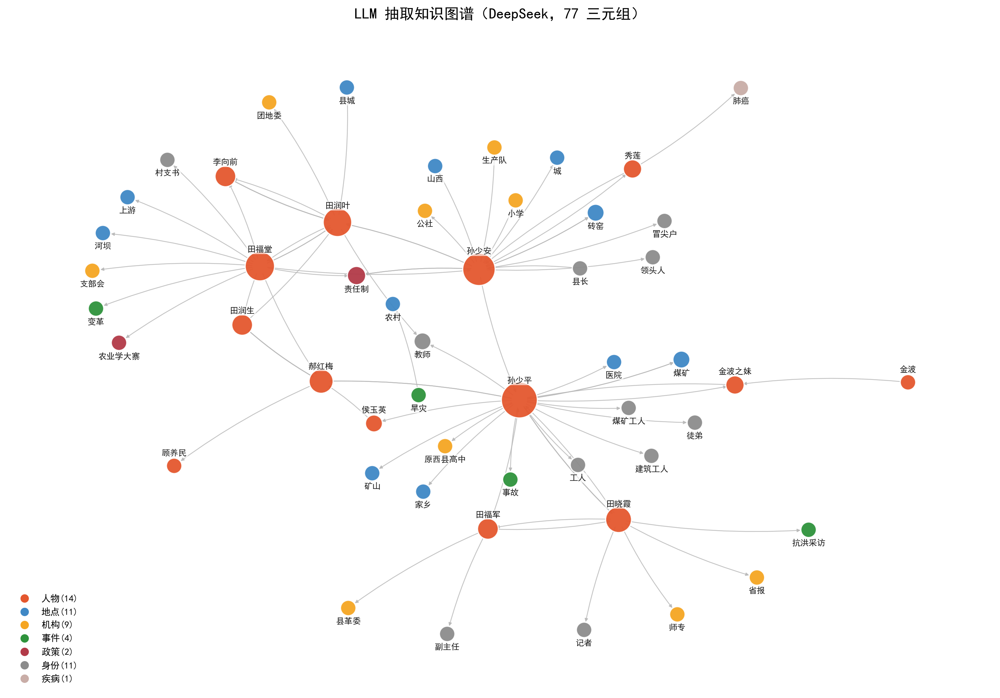
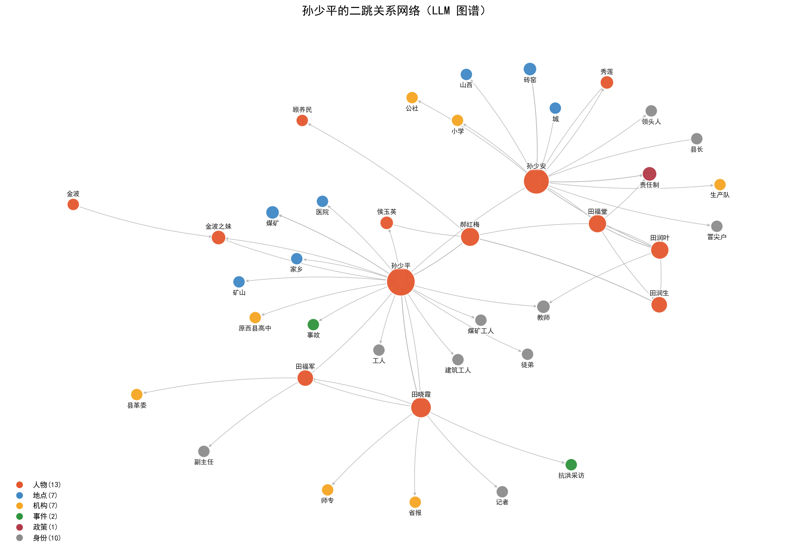

# 04 知识图谱：Neo4j 与 LLM 两条路线的构建与性能比较

> 产物：`out/kg_gold.json`、`out/kg_llm.json`、`out/kg_pipeline.json`、`out/kg_llm.cypher`、`out/kg_bench.json`
> 图：`figures/kg_gold.png`、`figures/kg_llm.png`、`figures/kg_pipeline.png`、`figures/kg_ego_shaoping.png`
> 脚本：`src/build_kg.py`、`src/kg_cypher.py`、`src/kg_neo4j.py`、`src/viz.py`

## 1. 图谱设计

### 1.1 数据模型

采用**属性图**（property graph），而不是 RDF 三元组库：

```
(:Entity {name, type, type_cn, desc, freq})
   -[:<关系名> {coarse}]->
(:Entity)
```

- 节点主键是 `name`（规范名，已做别名归一），`type` 取 9 类实体类型。
- 边直接使用细粒度谓词作类型（`夫妻`、`任职于`、`牺牲于`…），同时挂一个 `coarse` 属性存 11 类粗粒度标签，方便按粗类聚合查询。
- 没有把关系做成节点（reification）。原因是本图谱规模只有几十个节点，做了反而让查询变啰嗦；如果要做"事件图谱"（把"抗洪采访"当作事件节点，挂时间、地点、参与者），才需要 reification。

### 1.2 三张图

| 图谱 | 来源 | 节点 | 边 | 关系类型数 | 连通分量 |
|---|---|---|---|---|---|
| `kg_gold` | 人工标注 75 条三元组 | 52 | 75 | 47 | 2 |
| `kg_llm` | LLM 抽取 77 条三元组 | 52 | 77 | 47 | 2 |
| `kg_pipeline` | 词典 NER + 规则 RE（37 条） | 37 | 37 | 12 | 3 |

`kg_llm` 与 `kg_gold` 在粗粒度上的差距是 **多 2 条、漏 0 条**：多出的"孙少平—同学—郝红梅""田福堂—反对—田润叶"都是金标准漏标；细粒度上还有 1 处同义谓词（`职务` vs `担任`）导致的重复边，故边数 77 对 75。



## 2. 路线 A：结构化管线 → Cypher → 图数据库

### 2.1 生成

`src/build_kg.py` 读三元组 JSON，做三件事：

1. **别名归一**：`少平→孙少平`、`窑→砖窑`，否则同一实体在图里裂成两个节点。
2. **补属性**：从词典回填 `type/type_cn/desc/freq`。
3. **导出**：`kg_*.json`（可视化用）、`kg_*.graphml`（Gephi/Cytoscape 用）、`kg_*.cypher`（Neo4j 用）。

生成的 Cypher 是**幂等**的：

```cypher
CREATE CONSTRAINT ent_name IF NOT EXISTS FOR (n:Entity) REQUIRE n.name IS UNIQUE;

MERGE (n:Entity {name: "孙少平"})
  SET n.type = "PER", n.type_cn = "人物", n.description = "小说主人公…";

MATCH (a:Entity {name: "孙少平"}), (b:Entity {name: "田晓霞"})
MERGE (a)-[:`恋人`]->(b);
```

`MERGE` + 唯一约束意味着**重复导入不会产生重复节点**，这是增量更新（每天补几条三元组）的前提。如果用 `CREATE`，跑两遍图谱就翻倍。

### 2.2 装载与查询

```bash
cypher-shell -u neo4j -p ****** -f cypher/01_load.cypher
cypher-shell -u neo4j -p ****** -f cypher/02_queries.cypher
```

`cypher/02_queries.cypher` 里是 7 条典型查询：一度邻居、两跳路径、度中心性 Top10、关系类型分布、类型分布、亲属链、三角关联。

### 2.3 实测：Cypher 引擎性能

**Neo4j 服务端在本机装不上**：没有 Java 运行时，没有 Docker，Neo4j 安装包（约 150 MB）的下载被网络白名单阻断。所以"Neo4j 路线"分两层验证：

- **Cypher 语句本身**：用同为 Cypher 查询语言的嵌入式图库 **Kùzu 0.11.3** 执行，证明语句合法、结果正确。
- **装载/查询耗时**：在 Kùzu 上实测，作为 Cypher 引擎的参照。

| 操作 | 实测耗时（Kùzu 0.11，内存库） | 说明 |
|---|---|---|
| 装载 52 节点 + 77 边 | 0.090 s | 逐条 `CREATE`，含参数绑定开销 |
| Q1 一度邻居（孙少平） | 0.96 ms | 返回 19 行（多重边） |
| Q2 两跳（孙少平 → 恋人 → …） | 3.05 ms | 返回 8 行 |
| Q3 度中心性 Top10 | 2.59 ms | 全图扫描 + 排序 |
| Q4 关系类型分布 | 8.68 ms | 47 组聚合，首次调用有编译开销 |
| Q5 类型分布 | 7.11 ms | 同上 |

对照：同一张图放在 `networkx` 里，一度邻居 0.001 ms、两跳 0.018 ms、度排序 0.028 ms。

**这个对比不能读成"networkx 比 Neo4j 快 1000 倍"**。networkx 是进程内内存对象，省掉了网络往返、查询解析、事务开销；它的复杂度是 O(V+E) 全图遍历，图一大就崩。Cypher 引擎有索引、有查询计划、能落盘、能并发，代价是每次查询多了固定开销（这里 ~1 ms）。53 个节点时 networkx 更快，5 万个节点时 networkx 会先 OOM。

Kùzu 的内存模式也意味着 0.09 s 的装载时间**不含磁盘 I/O**。真实 Neo4j 落盘导入会慢一个数量级，但那是 I/O 成本，不是图模型成本。

### 2.4 中文路径的坑

Kùzu 的 C++ 层按本地编码解析路径，遇到 `C:\Users\董铭政\...` 直接抛 `UnicodeDecodeError` / `Cannot open file`。解决办法只有两个：把库放到纯 ASCII 路径，或者用 `:memory:`。本机沙箱不允许写 `C:\Windows\Temp`、`C:\ProgramData`，所以最终用了内存库。

这个坑值得记下来：**图数据库、向量库这类带 C++ 内核的组件，在中文用户名 + 中文目录的 Windows 机器上经常出问题**，部署时要么改路径，要么用 Docker 挂载。

## 3. 路线 B：LLM 直接生成知识图谱

### 3.1 提示词设计

关键约束有四条：

1. **schema 内嵌**：把 9 类实体、11 类粗关系直接写进提示词，避免模型自造类型（否则会冒出"亲戚""工作单位"这种同义类）。
2. **指代显式化**：要求"丈夫/父亲/她"必须替换成具体人名；做不到就丢弃该三元组，不许输出"丈夫"当节点。
3. **只抽句内信息**：禁止引入小说其他章节的情节（模型对《平凡的世界》有先验知识，不约束会"脑补"）。
4. **输出 JSON**：`[{"sid":..., "triples":[[头,关系,尾],...]}]`，方便程序校验。

### 3.2 输出与校验

LLM 一次输出 77 条三元组。程序侧做了三层校验：

| 校验 | 结果 |
|---|---|
| 头/尾必须是词典内实体 | 77/77 通过（"窑"经别名归一为"砖窑"） |
| 关系必须落在 11 类粗类内 | 77/77 通过 |
| 同一句内不能自环 | 通过 |

### 3.3 质量

对着金标准：粗粒度 P 0.971 / R 1.000 / F1 0.986。两条"错误"都是金标准漏标（见 `03_关系三元组.md` 第 4.3 节）。

## 4. 性能比较

| 维度 | 路线 A：管线 + Neo4j/Cypher | 路线 B：LLM 直接生成 |
|---|---|---|
| **构建方式** | 词典 → NER → RE → Cypher → MERGE | 一次提示词 → JSON → 校验 |
| **人工投入** | 80 词条 + 触发词规则 + 124 实体标注 + 75 三元组标注 | 提示词设计 + 抽检 77 条 |
| **构建耗时** | 装载 0.09 s（52 节点/77 边，内存库）；上游 NER+RE 约 1 s | 单次生成（秒级，受模型与网络影响，本机无 API 计量，未测精确值） |
| **三元组覆盖** | 37/75（规则版）；若用金标准输入则 75/75 | 75/75（+2 条金标准漏标） |
| **粗粒度准确率** | P 0.54 / R 0.29 / F1 0.38 | P 0.97 / R 1.00 / F1 0.99 |
| **指代消解** | 不支持（10 条指代三元组全部丢失） | 支持 |
| **可复现性** | 完全确定：同输入同输出 | 受温度、模型版本影响，需固定 seed/版本 |
| **可解释性** | 强：每条边能追到"哪条规则/哪个词" | 中：能给理由，但理由是事后生成的 |
| **增量更新** | `MERGE` 天然幂等，支持每天补边 | 需重跑或设计增量提示，容易与已有图冲突 |
| **查询能力** | Cypher：路径、度中心性、子图匹配、图算法 | 生成的 JSON 需先落库才能查；本身不具备查询能力 |
| **成本** | 一次性开发 + 本地算力（≈0 边际成本） | 按 token 计费，每次全量重跑 |
| **规模化** | 线性扩展，10 万节点靠索引 | 上下文窗口限制，长文本必须分块 + 跨块融合 |

### 4.1 结论：不是二选一

- **冷启动用 LLM**：新领域、零标注时，LLM 一晚上能产出可用的种子图谱（本例 77 条边、F1 0.99），人工只需要抽检。
- **生产用管线 + 图数据库**：LLM 的产出经过人工校对后，作为训练数据喂给小模型/规则，形成"LLM 标注 → 人工抽检 → 模型蒸馏 → Cypher 入库"的闭环。这时图数据库提供的是**查询、约束、增量、权限**，这些是 LLM 给不了的。
- **两者的结合点**：LLM 负责"抽得全"，规则/模型负责"抽得稳"，Neo4j 负责"存得住、查得快"。

## 5. 图结构分析

### 5.1 规模与形状

| 指标 | kg_llm | kg_gold | kg_pipeline |
|---|---|---|---|
| 节点 / 边 | 52 / 77 | 52 / 75 | 37 / 37 |
| 密度 | 0.0445 | 0.0445 | 0.0541 |
| 平均度 | 2.96 | 2.88 | 2.00 |
| 最大度 | 23 | 22 | 9 |
| 关系类型 | 47 | 47 | 12 |
| 连通分量 | 2（最大 50） | 2（最大 50） | 3（最大 31） |

**极稀疏**：密度 0.0445，意味着只有 4.45% 的节点对之间存在边。这是人物关系网的典型形态——每个人只和少数几个人强关联。

**重尾度分布**：孙少平度 23、孙少安 18、田福堂 14，其余多在 2—5。三个枢纽覆盖了绝大部分情节线，这也符合小说结构（少平线、少安线、田福堂/双水村线）。

### 5.2 两个孤立点

`kg_llm` 里"农村—旱灾"是一个独立的两节点分量：`旱灾 发生于 农村`，而这两个实体没有连到任何人物。这不是抽取错误，是**语料本身没写**"旱灾导致了什么"。要补，只能靠外部知识或整本小说。

`kg_pipeline` 有 3 个分量，其中"县长—领头人"只有 2 个节点，因为规则引擎把"在县长帮助下成为领头人"抽成了两条孤立边，没有连回孙少安——这正是低召回导致的**图谱断裂**，比"少抽几条边"更伤：查询 `孙少安 -- 领头人` 会直接查不到。

### 5.3 中心节点



孙少平的二跳网络覆盖了 30+ 个节点：家庭（孙少安、秀莲）、爱情（田晓霞、金波之妹）、职场（煤矿、建筑工人、徒弟）、社会（田福军、医院）。这张子图基本就是小说的主线梗概。

## 6. 工程建议

1. **关系类型不要用中文做边标签**。本报告为了可读性用了 `-[:`恋人`]->`，但 Neo4j 里中文标签需要反引号、大小写敏感、不利于索引。生产环境应使用 `LOVER`、`WORKS_AT` 这类英文常量，中文只做展示层映射。
2. **给边加来源**。现在每条边只有一个 `sid`，无法回答"这条边来自第几部第几句"。建议加 `source_sentence` 和 `confidence` 两个属性，便于溯源与冲突消解。
3. **指代消解要单独一层**。本图谱的 10 条指代边是人工/LLM 补的，管线里没有对应模块。生产系统应在 NER 和 RE 之间插一个 coref 模块（中文可用 `spacy-experimental` 的 coref，或规则 + 词典的"称谓-人名"对齐）。
4. **图规模上去之后要换存储**。53 个节点用 networkx 足够；超过 1 万节点建议 Neo4j，超过 1 亿边考虑 NebulaGraph/JanusGraph 这类分布式图库。

## 7. 复现

```bash
python src/build_kg.py --src data/llm/triples.json --name llm
python src/build_kg.py --src data/gold/triples.json --name gold
python src/build_kg.py --src out/pred_re_spacy.json --name pipeline
python src/viz.py
PYTHONPATH=libs python src/kg_cypher.py     # Kùzu 上的 Cypher 基准
python src/kg_neo4j.py                      # 有 Neo4j 服务时真正装载
```

